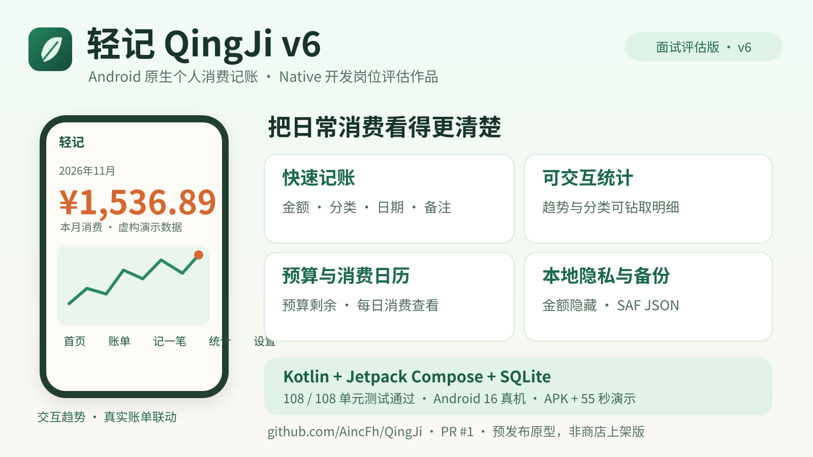

# 轻记 QingJi v6｜Native 开发岗位评估交接

> 日期：2026-11-05 · 项目：Android 原生离线个人消费记账 App · 用途：面试评估原型（非应用商店正式发行）

## 一、快速了解项目

**轻记 QingJi** 以日常记账和可交互的消费可视化为核心，保留温暖纸白、松绿与柿橙的视觉语言。用户可以随时新增、编辑、删除消费记录，检索历史、点击趋势或分类查看对应流水，并查看消费日历及月度预算进度。

- **首页**：月度支出、7 日趋势与分类占比、近期流水
- **账单**：按日期分组、备注搜索、月份/类别/关键词组合筛选
- **统计**：7/30 日趋势、分类构成、历史月份及同期对比；数据点可钻取真实账单
- **记账**：金额键盘、分类/日期/备注、历史复制和即时聚合刷新
- **预算/日历**：月度预算、余额/比例及按日汇总消费
- **设置与隐私**：系统/浅色/深色模式，隐藏金额、TalkBack 读屏描述
- **离线备份**：Android Storage Access Framework（SAF）导出/导入 JSON，文件校验、恢复预览及同 backupId 去重合并

## 二、工程与测试

- Kotlin + Jetpack Compose + Material 3 + SQLiteOpenHelper + StateFlow
- 源码分支：[codex/qingji-v6-integration](https://github.com/AincFh/QingJi/tree/codex/qingji-v6-integration)
- 版本提交：[`49b6ded`](https://github.com/AincFh/QingJi/commit/49b6dedf13298ddc27a01569eb9265aa3d75d2af)
- 集成审阅：[PR #1](https://github.com/AincFh/QingJi/pull/1)，当前尚未合并 main
- 开发日志报告 108 / 108 JVM 单测通过、Lint 0 错误 / 10 警告，Android Test 源码可编译
- Redmi 25057RA09C / Android 16 / API 36 上完成业务、持久化和隐私展示验收

## 三、交付文件与 SHA-256

交付版 APK、视频文件与可选演示 JSON 的准确文件名和 SHA：

| 文件 | 大小 | SHA-256 |
|---|---:|---|
| `QingJi-v6-release-signed.apk` | 7,595,190 B | `ca06bdc6bb2dd9facd8adfb46d789ca514064856451f19046728b7db9fb5510f` |
| `qingji_v6_demo_manual.mp4` | 8,043,332 B | `83d51b74f644581b55be04ece3d9317ea6f6604b79ad5adee59799663e07a99a` |
| `qingji_backup_final_verify.json` | 170,442 B | `41da197921442b3a0796e68d59738efcce84ac0187d0c50ad7c9b63ad9acd330` |

视频是 55.14 秒连续真机操作，720×1280、H.264、无音轨。展示首页、账单、编辑、新增 ¥255 消费、统计与设置。录屏中月度金额随新增真实更新为 ¥1,536.89。**视频未演示预算与日历页面**，可结合源码与真机 QA 截图进一步评估。

可选 JSON 内为 **693 笔虚构消费、11 个月预算**，并非真实个人账单；首次安装 App 默认空账本，不会自动载入演示数据。需要在应用中主动选择导入。

## 四、重要工程边界

- APK 是 **Release 构建**，但使用 **Android Debug 签名证书（v2/v3）**，方便在开发设备覆盖安装保留数据，**不是独立生产证书**，不用于应用商店正式发布。
- 源码 Release 配置 `isMinifyEnabled = false`，不能声称已开启 R8 代码压缩或混淆。
- 数据在设备本地持久化；App 不申请网络权限。
- SAF JSON 导出已通过真机验证；导入合并曾使用同内容 `.txt` 副本诊断 MIUI 对 JSON MIME 文件过滤的兼容性。
- `connectedDebugAndroidTest` 曾被设备策略限制（`INSTALL_FAILED_USER_RESTRICTED`），未实际执行；不将其计入自动测试通过数。
- 演示模式/一键示例账本未实现；若在新设备评估数据可视化，可使用上面的可选虚构 JSON 数据。
- 本作品从零开发，使用 AI Coding / Agent 辅助工程实现，需求定义、流程验收、测试和交付工作由开发者负责。

## 五、查看源码与交付

[GitHub 源码分支](https://github.com/AincFh/QingJi/tree/codex/qingji-v6-integration) · [PR #1 审阅记录](https://github.com/AincFh/QingJi/pull/1) · [Releases 页面](https://github.com/AincFh/QingJi/releases)

> 请以实际已经发布、且包含附件的 Release 页面为下载入口；仅有源码 PR 不代表 APK 和视频已上传。